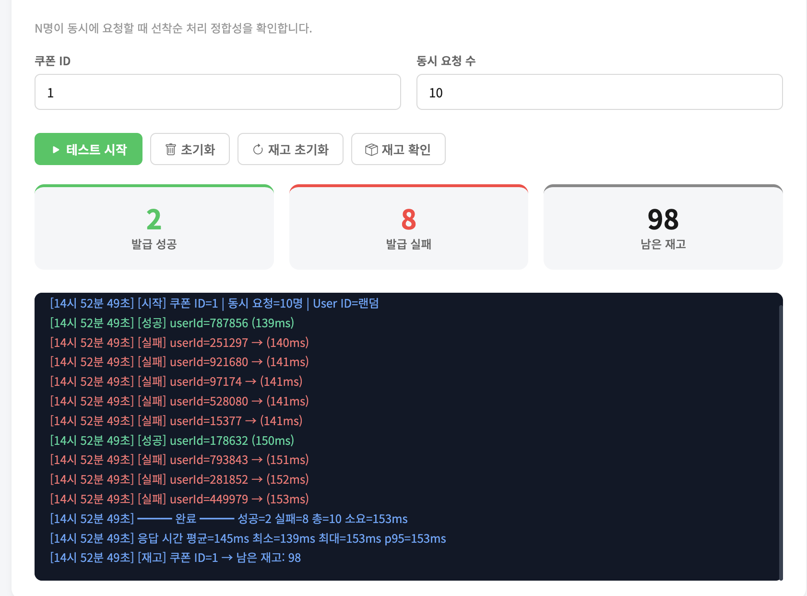
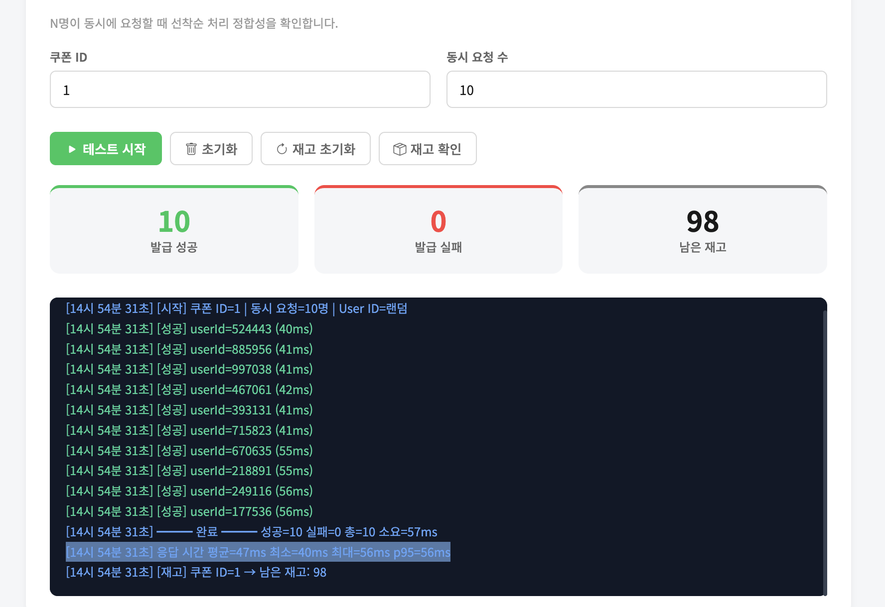
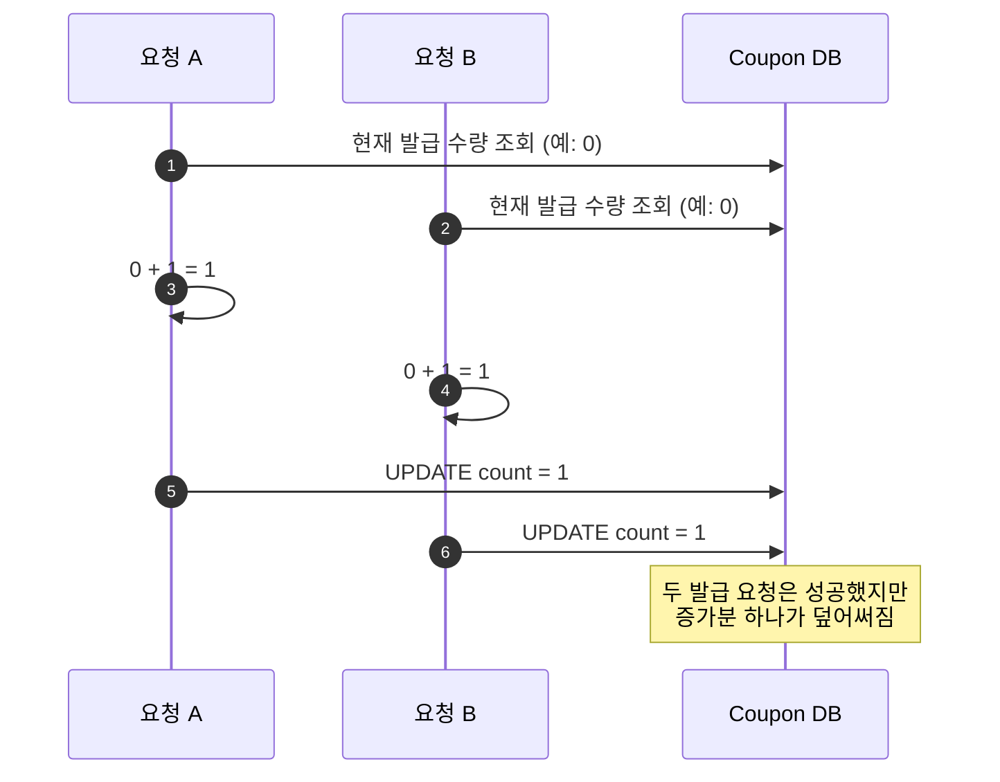
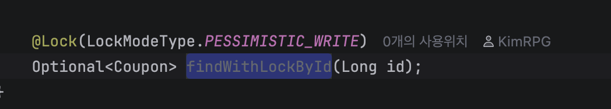
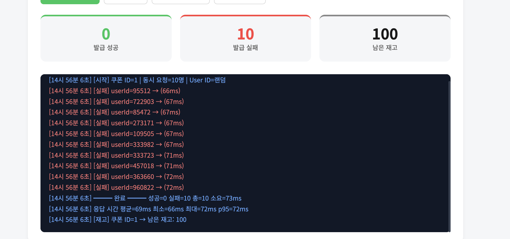
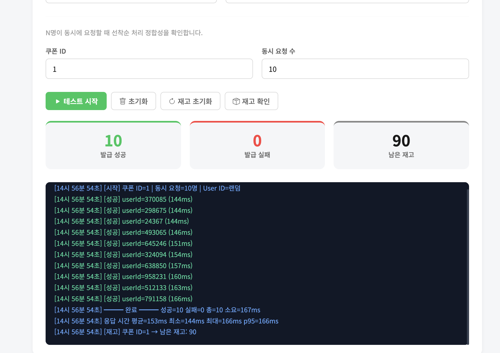
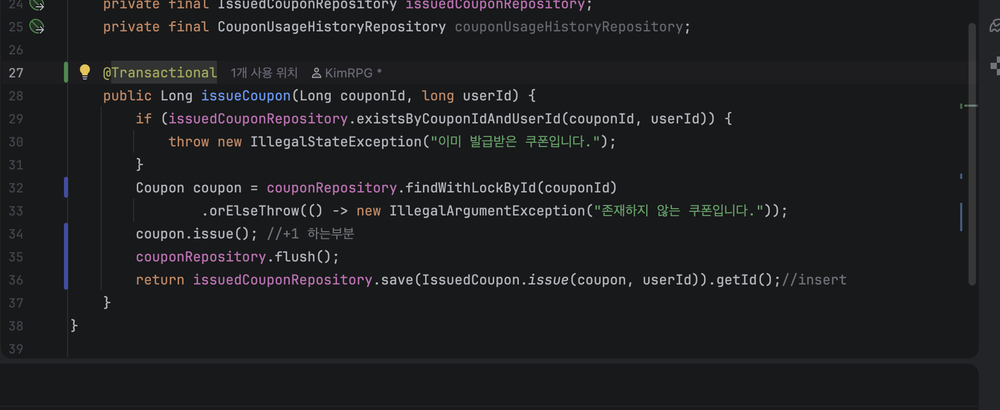
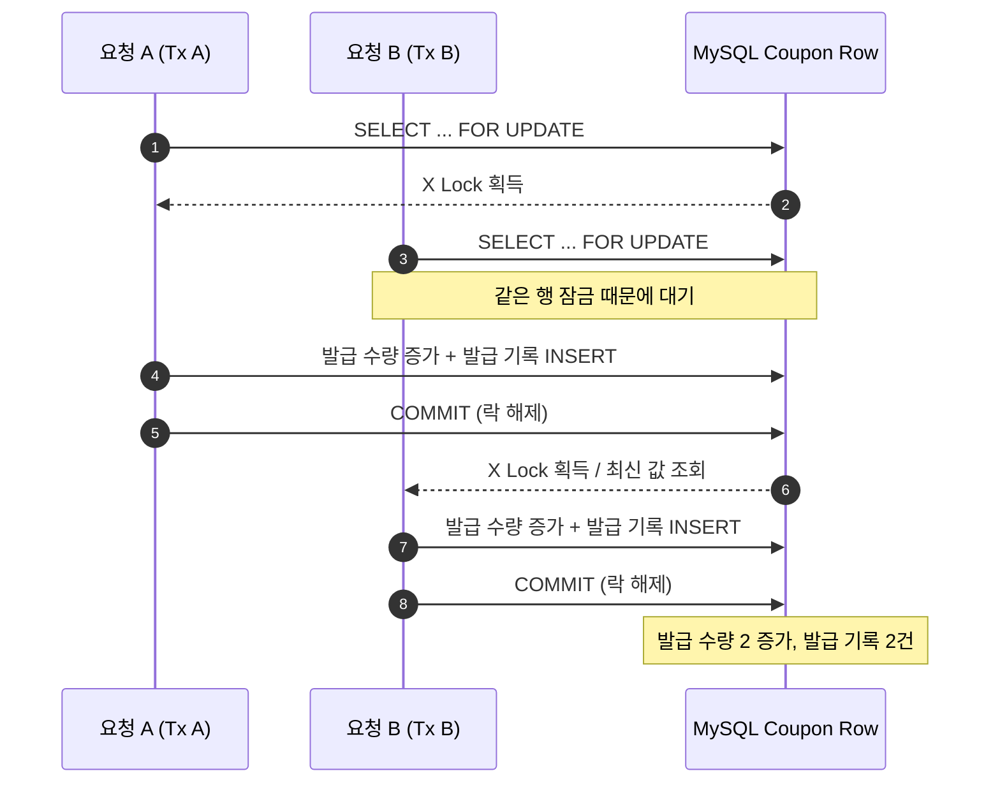

# 🎟️ 쿠폰 발급 동시성 문제 분석 및 해결

> **Spring Boot · Spring Data JPA · MySQL/InnoDB · 동시 요청 10건**

## 📌 요약

| 실험 | 적용 방식 | 성공 | 실패 | 평균 응답 | 발급 후 재고 | 평가 |
|:--|:--|--:|--:|--:|--:|:--|
| ① | 기본 JPA 발급 | 2 | 8 | **145ms** | 98 | ❌ 다수 실패 |
| ② | `flush()` 추가 | 10 | 0 | **47ms** | 98 | ⚠️ 재고 불일치 |
| ③ | `PESSIMISTIC_WRITE`만 추가 | 0 | 10 | **69ms** | 100 | ❌ 트랜잭션 필요 |
| **④** | **`PESSIMISTIC_WRITE` + `@Transactional`** | **10** | **0** | **153ms** | **90** | **✅ 이번 테스트 통과** |

**테스트 조건:** 쿠폰 ID `1` · 초기 재고 **100개** · 서로 다른 랜덤 사용자 **10명** · 동시 요청 **10건**. 아래 평균·최소·최대·p95는 제공된 단일 실험 로그 값이며 반복 측정에 따른 통계적 검증은 수행하지 않았다.

---

## 1. 문제 정의

쿠폰을 발급할 때는 다음 두 작업이 함께 이뤄져야 한다.

1. `Coupon` 엔티티의 발급 수량을 1 증가 (`UPDATE`에 해당).
2. `IssuedCoupon` 엔티티를 저장하여 사용자에게 발급 내역을 남김 (`INSERT`).


```java
public Long issueCoupon(Long couponId, long userId) {
    if (issuedCouponRepository.existsByCouponIdAndUserId(couponId, userId)) {
        throw new IllegalStateException("이미 발급받은 쿠폰입니다.");
    }

    Coupon coupon = couponRepository.findWithLockById(couponId)
        .orElseThrow(() -> new IllegalArgumentException("존재하지 않는 쿠폰입니다."));

    coupon.issue();               // 발급 수량 +1
    //couponRepository.flush();     // 변경 SQL 조기 실행 요청

    return issuedCouponRepository
        .save(IssuedCoupon.issue(coupon, userId))
        .getId();
}
```

위 코드는 중간 실험에서 수정한 형태로, **최종 실험에서는 서비스 메서드에 `@Transactional`이 추가**되었다. 동일한 쿠폰에 여러 요청이 몰릴 때 `issue()`의 증가분이 모두 DB에 반영되어야 한다.

```text
초기 상태         쿠폰 재고 100개
동시 요청         서로 다른 사용자 10명
기대 발급 결과    성공 10건 / 실패 0건
기대 최종 상태    재고 90개
```

## 2. 실험 ① — 기본 JPA 발급: 요청 충돌과 실패

```java
public Long issueCoupon(Long couponId, long userId) {
    if (issuedCouponRepository.existsByCouponIdAndUserId(couponId, userId)) {
        throw new IllegalStateException("이미 발급받은 쿠폰입니다.");
    }

    Coupon coupon = couponRepository.findWithLockById(couponId)
        .orElseThrow(() -> new IllegalArgumentException("존재하지 않는 쿠폰입니다."));

    coupon.issue();               // 발급 수량 +1
    //couponRepository.flush();     // 변경 SQL 조기 실행 요청

    return issuedCouponRepository
        .save(IssuedCoupon.issue(coupon, userId))
        .getId();
}
```



| 지표 | 측정값 |
|---|---:|
| 성공 / 실패 | **2건 / 8건** |
| 평균 응답 시간 | **145ms** |
| 최소 / 최대 | 139ms / 153ms |
| p95 | 153ms |
| 최종 재고 | **98개** |

**관찰:** 동시 요청 10건 중 2건만 발급에 성공했다. 최종 재고도 성공 건수만큼 감소한 98개였다.

**원인 분석:** 동일한 쿠폰 행을 여러 요청이 읽고 변경하는 상황에서는 락 획득 순서, 잠금 대기, 트랜잭션 경계에 따라 충돌이 발생할 수 있다. 특히 DB 실행 계획과 격리 수준에 따라 공유 락(S Lock)에서 배타 락(X Lock)으로의 전환을 기다리는 교착 상황이 생길 수 있다.

## 3. 실험 ② — `flush()` Lost Update

**가설:** JPA가 변경 SQL을 미루지 않고 `UPDATE`를 먼저 실행하도록 강제하면 충돌이 줄어들지 않을까?

```java
coupon.issue();
couponRepository.flush();
return issuedCouponRepository
    .save(IssuedCoupon.issue(coupon, userId))
    .getId();
```



| 지표 | 측정값 |
|---|---:|
| 측정 시각 | 14:54:31 |
| 성공 / 실패 | **10건 / 0건** |
| 평균 응답 시간 | **47ms** |
| 최소 / 최대 | 40ms / 56ms |
| p95 | 56ms |
| 최종 재고 | **98개 (기대값 90개)** |

**관찰:** 모든 요청이 성공했다. 그러나 10장의 쿠폰 발급에 성공했음에도 실제 재고는 2개만 감소했다.

### 왜 10건 성공인데 재고는 2개만 줄었을까?



이 현상은 **Lost Update(갱신 손실)**로 설명할 수 있다. 읽은 값에 `+1`을 수행하여 다시 저장하는 과정이 동시 요청에 대해 하나의 원자적 연산으로 보호되지 않았기 때문이다.

`flush()`는 영속성 컨텍스트의 변경사항을 SQL로 **일찍 전달**할 뿐, 읽기 → 계산 → 쓰기 전체의 **직렬 실행이나 트랜잭션 커밋을 보장하지 않는다.** 따라서 이 실험은 **API 성공만 보고 동시성 제어에 성공했다고 판단하면 안 된다**는 것을 보여준다.

> [!CAUTION]
> 이 실험에서 최종 재고 98개는 관찰된 결과이며, 어떤 요청끼리 정확히 값을 덮어썼는지는 SQL 로그 없이 확정할 수 없다.

## 4. 실험 ③ — 비관적 쓰기 락 적용: 트랜잭션 부재 오류

락으로 쿠폰 행을 보호하기 위해 Repository 조회 메서드에 JPA의 비관적 쓰기 락을 지정했다.

```java
@Lock(LockModeType.PESSIMISTIC_WRITE)
Optional<Coupon> findWithLockById(Long id);
```





| 지표 | 측정값 |
|---|---:|
| 측정 시각 | 14:56:06 |
| 성공 / 실패 | **0건 / 10건** |
| 평균 응답 시간 | **69ms** |
| 최소 / 최대 | 66ms / 72ms |
| p95 | 72ms |
| 최종 재고 | **100개** |

모든 요청이 실패했고, 서버 로그에는 다음 예외가 기록되었다.

```text
jakarta.persistence.TransactionRequiredException:
Query requires transaction be in progress,
but no transaction is known to be in progress

at ...$Proxy121.findWithLockById(...)
at IssueCouponService.issueCoupon(IssueCouponService.java:31)
```

**원인:** `PESSIMISTIC_WRITE`는 데이터베이스 잠금을 획득하는 조회다. Hibernate가 이 쿼리를 실행할 때 활성 트랜잭션이 필요하지만, 호출 경로에 필요한 트랜잭션이 없어서 쿼리가 거부되었다. 이 경우 **락 획득 및 데이터 변경 전에 예외가 발생**한다.

즉, **`@Lock`만 선언한다고 락의 생명주기를 관리할 수 있는 것은 아니다.** 서비스의 읽기 → 수정 → 발급 내역 저장까지 하나의 트랜잭션으로 묶어야 한다.

## 5. 실험 ④ — `@Transactional` + 비관적 쓰기 락: 정합성 확보

서비스 메서드에 `@Transactional`을 적용했다.

```java
@Service
@RequiredArgsConstructor
public class IssueCouponService {

    private final CouponRepository couponRepository;
    private final IssuedCouponRepository issuedCouponRepository;

    @Transactional
    public Long issueCoupon(Long couponId, long userId) {
        if (issuedCouponRepository.existsByCouponIdAndUserId(couponId, userId)) {
            throw new IllegalStateException("이미 발급받은 쿠폰입니다.");
        }

        Coupon coupon = couponRepository.findWithLockById(couponId)
            .orElseThrow(() -> new IllegalArgumentException("존재하지 않는 쿠폰입니다."));

        coupon.issue();
        couponRepository.flush(); // 유지 가능하나 잠금 보장의 핵심은 아님

        return issuedCouponRepository
            .save(IssuedCoupon.issue(coupon, userId))
            .getId();
    }
}
```

```java
public interface CouponRepository extends JpaRepository<Coupon, Long> {
    @Lock(LockModeType.PESSIMISTIC_WRITE)
    @Query("select c from Coupon c where c.id = :id")
    Optional<Coupon> findWithLockById(@Param("id") Long id);
}
```

> `@Query`는 예시를 명확히 하기 위한 것으로, 실제 메서드가 정상 매핑되고 있다면 기존 선언을 유지할 수 있다.





| 지표 | 측정값 |
|---|---:|
| 측정 시각 | 14:56:54 |
| 성공 / 실패 | **10건 / 0건** |
| 평균 응답 시간 | **153ms** |
| 최소 / 최대 | 144ms / 166ms |
| p95 | 166ms |
| 최종 재고 | **90개 (기대값 일치)** |

### 정상 동작 원리



MySQL/InnoDB에서 일반적으로 `PESSIMISTIC_WRITE`는 `SELECT ... FOR UPDATE`에 대응한다. **동일한 쿠폰 행에 접근하는 요청들이 잠금 해제를 기다리며 순차적으로 변경**하기 때문에, `issue()`의 증가분이 덮어써지는 것을 방지한다. `@Transactional`은 잠금 획득부터 발급 내역 저장 및 커밋까지 하나의 작업으로 묶어준다.

### 결과 해석

- ✅ 발급 성공 10건
- ✅ 최종 재고 90개: 100 − 10 = 90
- ✅ 이번 실험에서는 실패와 재고 불일치 없음
- ⚠️ 평균 응답은 47ms(`flush()` 실험) 대비 153ms로 증가: 동일 행에 대한 잠금 대기가 발생할 수 있으며, 정확한 지연 구성은 추가 추적이 필요함

---

## 6. S Lock, X Lock, Flush, Transaction의 차이

| 개념 | 무엇을 보장하나? | 주의 사항 |
|---|---|---|
| **S Lock** (Shared) | 다른 공유 락과 동시 보유 가능 | X Lock 획득과 충돌 가능 |
| **X Lock** (Exclusive) | 동일 행의 충돌하는 변경/잠금을 배타적으로 제어 | 잠금 대기로 응답 지연 가능 |
| **`flush()`** | JPA 변경사항을 DB SQL로 반영하도록 동기화 | 커밋 아님. 동시성/원자성 보장 수단 아님 |
| **`@Transactional`** | 작업을 하나의 트랜잭션 경계로 관리 | 이것만으로 모든 경쟁 조건이 자동으로 해결되지는 않음 |
| **`PESSIMISTIC_WRITE`** | 대상 행에 쓰기 잠금을 요청 | 활성 트랜잭션에서 사용해야 함 |

**중요:** 기본 JPA 조회가 무조건 S Lock을 획득하는 것은 아니다. MySQL InnoDB의 일반적인 `SELECT`는 MVCC 기반의 비잠금 일관성 읽기다. **실제 S/X 데드락 여부**는 조회 SQL, 인덱스, 격리 수준, DB 데드락 로그를 함께 확인해야 한다.

